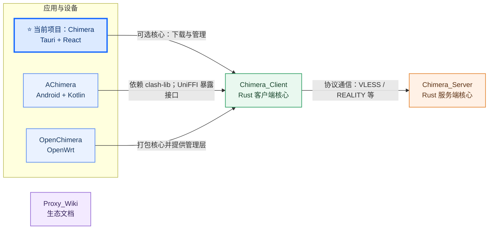

# Chimera

> 下一代主机网络管家：让网络管理更简单、更可靠，并尽可能无感地运行在后台。

[](#)
[](#)
[](#)
[](#)
[](#)

简体中文 | [English](README.en.md) | [Русский](README.ru.md) | [فارسی](README.fa.md)

> **Chimera Proxy** 是 Chimera 代理生态的 Rust 原生桌面客户端。

## Chimera Ecosystem

图中，应用到客户端核心表示集成或依赖；客户端到服务端表示网络协议通信；Proxy_Wiki 提供文档，不参与运行时。



**当前项目适用系统：**
  

- [Chimera](https://github.com/MFSGA/Chimera) — Tauri、React 和 Rust 桌面代理管理应用。
- [Chimera_Client](https://github.com/MFSGA/Chimera_Client) — Rust 客户端核心，基于 `clash-rs` 方向开发；桌面端、Android 和 OpenWrt 集成会使用它。
- [Chimera_Server](https://github.com/MFSGA/Chimera_Server) — Rust 服务端核心，目标是部分兼容 Xray；目前重点完善入站能力。
- [AChimera](https://github.com/MFSGA/AChimera) — Kotlin Android 客户端，依赖 `Chimera_Client` 的 `clash-lib`，并通过 UniFFI 调用 Rust 接口。
- [OpenChimera](https://github.com/MFSGA/OpenChimera) — 将 `Chimera_Client` 打包为 OpenWrt 核心，并提供 UCI 配置和 procd 服务管理。
- [Proxy_Wiki](https://github.com/MFSGA/Proxy_WIKI) — 项目、协议和部署文档。[在线阅读](https://mfsga.github.io/Proxy_WIKI/)

## 项目简介

Chimera 的目标是成为下一代最好用的主机网络管家：在 Windows、macOS 与 Linux/NixOS 上，把代理核心、系统网络设置和日常连接管理整合起来，让网络能力稳定、可靠地工作，并尽可能在后台无感运行。项目基于 Tauri、Rust 与 React 构建，也保留清晰的状态、日志和控制入口，让用户需要时能理解并掌控发生了什么。

NixOS 开发环境、依赖预检和运行注意事项参见 [NixOS 适配指南](docs/nixos.md)。

Chimera 也以 AI agent 友好为设计方向。主界面、legacy UI 与 AI agent 应复用同一套应用 API 和业务能力，避免 agent 维护一份平行的配置或运行逻辑。项目计划支持本地优先的 agent 工具，让 agent 能在本机协助检查网络状态、解释问题和完成配置任务；涉及修改的操作会保留用户控制，并提供可核验的执行结果。该能力仍在规划和建设中，不代表所有 agent 工具现已可用。

## 协议兼容矩阵

| 能力                    | 状态         |
| ----------------------- | ------------ |
| VLESS + REALITY         | Stable       |
| XHTTP                   | Stable       |
| TUN / DNS / REST API    | Stable       |
| Clash / Mihomo 核心兼容 | Partial      |
| VMess / Vision          | Experimental |

Chimera Desktop 负责桌面编排；具体协议能力取决于所选核心及其版本。

如果你希望有一个更专注于日常使用的网络管理工具，Chimera 的重点不是把界面做得复杂，而是让导入订阅、切换节点、查看连接、调整规则、管理核心和处理更新都尽量直接、可靠、少打扰。长期目标是让网络管理在后台妥善完成，只有需要用户决策或查看时才清楚地呈现出来。

## 为什么选择 Chimera

- 跨平台桌面体验：关注 Windows、macOS 与 Linux/NixOS 环境下的真实使用问题。
- 多核心支持方向：主要围绕 `chimera-client`、`clash-rs`、`mihomo` 等核心提供运行、切换、更新和状态管理能力。
- 全协议支持：覆盖常见代理协议组合，兼顾核心兼容性。
- 完整代理控制台：管理订阅与配置，查看代理组和节点，观察连接状态，调整运行时配置。
- 服务模式支持：适合追求更安全、更稳定后台运行、系统级代理能力和长期使用场景的用户。
- 日常排查友好：提供日志、连接、规则、配置目录和核心目录等入口，降低定位问题的成本。
- AI agent 友好方向：通过共享应用 API 让 GUI 与 agent 使用同一套业务能力，并计划支持本地优先、由用户掌控的 agent 工具。

## 当前支持协议

Chimera 当前重点关注常见代理组合与核心兼容，包括：

- `trojan + ws + tls`
- `reality + tcp`
- `hysteria2`
- `xhttp`

## 主要能力

- 订阅与 Profile 管理：支持导入、更新、删除、查看和编辑远程配置。
- 代理节点管理：支持查看代理组、选择节点，并在切换时同步刷新运行状态。
- 运行时配置：支持读取和调整 Clash 相关运行配置，方便排查和微调。
- 核心管理：支持查询核心状态、切换核心、重启 sidecar，并获取或更新核心版本。
- 系统集成：支持系统代理读取、应用深度链接、单实例启动、通知、对话框和进程管理。
- 服务模式：支持服务安装、卸载、启动、停止和重启。
- 更新能力：支持应用更新检查，并为核心版本更新保留独立管理链路。

## 常见开发命令

安装依赖：

```bash
pnpm install
```

准备核心信息：

```bash
pnpm generate:manifest
```

准备核心二进制资源并执行检查：

```bash
pnpm prepare:check
```

启动桌面应用：

```bash
pnpm dev:diff
```

构建应用：

```bash
pnpm build
```

## 贡献

- 有任何使用上的问题，或者代码实现上的问题，欢迎提 Issue 或 PR。
- 即使你是完全的新手，在查阅完 [wiki](https://mfsga.github.io/Proxy_WIKI/) 后，也可以继续有针对性地提问。
- 本项目也希望吸引更多开发者一起参与完善。

---

如果觉得有帮助，欢迎点个 star 🧡
